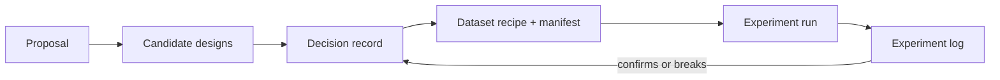

# Documents

Durable record of the project: what was proposed, decided, and run — kept
separate from `outputs/` (gitignored) and from chat transcripts.

```text
documents/
  README.md
  interim_proposal.pdf
  distributions/             candidate designs
  decisions/                 numbered decision records (ADR-style)
  experiments/               run log, audits, result summaries, figures
    README.md
    log.md
    results/<run-id>/
```

Sibling trees: [`datasets/`](../datasets/) (regenerated JSONL), [`configs/`](../configs/),
[`archive/`](../archive/) (superseded configs/scripts), `outputs/` (gitignored).

## How these fit together



## Audit index (date order)

| Date | Document | One line |
|---|---|---|
| 2026-10-21 | [experimental_audit_2026-10-21.md](experiments/experimental_audit_2026-10-21.md) | Do October result files exist and match the write-ups? |
| 2026-10-21 | [experimental_audit_addendum_2026-10-21.md](experiments/experimental_audit_addendum_2026-10-21.md) | Do those results support the status-report interpretation? |
| 2026-10-21 | [benchmark_audit_2026-10-21.md](experiments/benchmark_audit_2026-10-21.md) | First pass over metro_v3 label / structure issues. |
| 2026-10-22 | [benchmark_audit_deep_2026-10-22.md](experiments/benchmark_audit_deep_2026-10-22.md) | Deep pass; cycle_membership solver bug proven. |
| 2026-10-25 | [benchmark_v4_2026-10-25.md](experiments/benchmark_v4_2026-10-25.md) | metro_v4 design note and gate summary. |
| 2026-10-25 | [benchmark_v4_final_audit_2026-10-25.md](experiments/benchmark_v4_final_audit_2026-10-25.md) | Independent final audit; 75 pass / 0 fail. |
| 2026-10-25 | [v4_run_checklist.md](experiments/v4_run_checklist.md) | GPU server run checklist for v4. |

## Rule of thumb

If a run assumes a choice that is not yet in `decisions/`, lock it or mark the
run exploratory in `experiments/log.md`. Put released session recipes under
`datasets/` (manifest + regenerate command), not only under `outputs/`.
